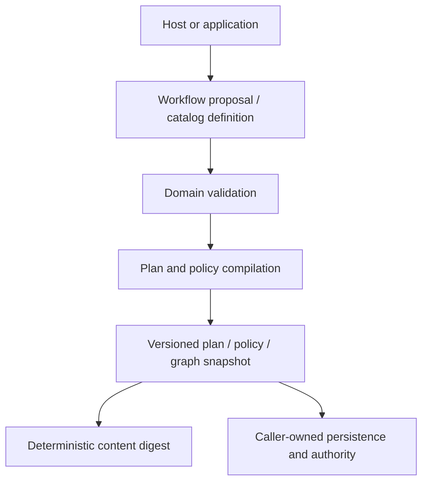

# Architecture

## Purpose

`workflow-domain` contains pure domain values and deterministic transformations shared by workflow hosts. It is deliberately below persistence, transport, provider, process, and authorization layers.

The host owns persistence, authentication, authorization, approval verification, execution, external side effects, and recovery. A successful call in this crate is only a successful domain operation.

## Module map

| Module | Responsibility |
|---|---|
| `lib.rs` | Workflow/task lifecycle values, proposal and plan validation, evidence references, graph nodes/edges/snapshots, digest helpers, domain errors. |
| `workflow.rs` | Artifact types, role capabilities and descriptive permissions, workflow definitions, role contracts, DAG compiler, immutable compiled plan. |
| `custom_workflow.rs` | Custom role/workflow validation against caller-supplied role and skill catalogs. |
| `artifact_contract.rs` | Typed artifact content contracts and local structural validation. |
| `workflow_catalog_v1.rs` | Versioned catalog/compiler structures and pinned content contracts. |
| `workflow_policy_v1.rs` | Versioned policy definitions, success predicates, policy snapshots and composition. |
| `node_compat.rs` | Read-only model of selected legacy Node workflow lifecycle transitions. |
| `node_execution.rs` | Typed read-only projection of selected Node execution metadata. |
| `node_plan_canonical_json.rs` | Compatibility serialization for selected Node plan values. |
| `node_scheduler.rs` | Read-only model of Node runnable-task candidate enumeration; not lease acquisition. |
| `node_task_retry.rs` | Read-only model of selected same-task retry preflight semantics. |
| `node_builtin_workflow.rs` | Test-only differential check against a pinned built-in workflow fixture. |

The `node_*` modules are optional compatibility surfaces, not a dependency on a running Node process. They are kept visibly separate from the generic domain model.

## Data flow

1. A caller constructs a proposal or versioned catalog definition.
2. Domain validation checks local structure, bounds, uniqueness, references, DAG acyclicity, and typed contracts.
3. Compilation produces an immutable plan snapshot with explicit versions and a content digest.
4. Policy and graph types represent additional constraints and evidence metadata as domain values.
5. The host persists snapshots and obtains any required authentication, verification, approval, and execution authority outside this crate.

## Invariants and limits

- No I/O, database, transport, provider, filesystem, process, or scheduling dependencies.
- Validation is not authorization; a compiled plan is not dispatch permission.
- Content hashes check content identity/consistency; they do not authenticate an author or prove claims.
- Evidence producer fields are caller-supplied claims until a separate verifier establishes provenance.
- `Unknown` outcomes remain distinct from success and failure.
- Workflow identifiers currently retain the extracted `job_` prefix requirement.
- Node compatibility modules model only their documented projection. Passing a differential fixture is not proof of complete Node parity.

## Dependency model

Runtime dependencies are limited to serialization (`serde`, `serde_json`), hashing (`sha2`, `hex`), and typed errors (`thiserror`). No dependency from this repository points back to Runalith or to a host application.
